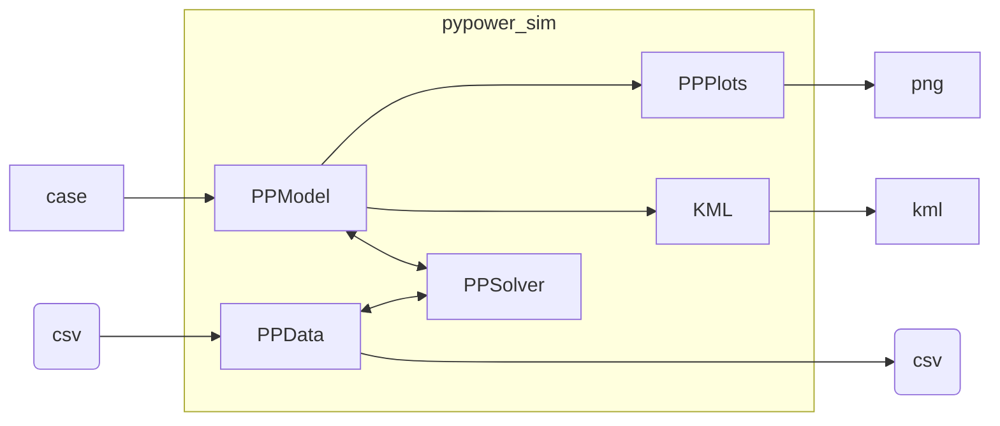

PyPOWER time-series simulator

`pypower_sim` runs quasi-steady time-series powerflow and optimal powerflow
simulations of [`pypower`](https://github.com/eudoxys/pypower) cases. It
reads a case file and CSV time-series inputs, solves each timestep with
`pypower` (and `cvxpy` for optimal capacity expansion), and writes CSV
outputs, PNG plots, and Google Earth KML maps. It is intended for power
system researchers and planners.

# Documentation

See https://www.eudoxys.com/pypower_sim

# Installation

Install using Eudoxys Package Manager:

    pip install --upgrade eudoxys
    epm install pypower_sim

Install using `pip`:

    pip install git+https://github.com/eudoxys/pypower_sim

# Maintenance

## Update docs

    make docs

## Run tests

    pip install -e . pytest
    pytest

The tests need no credentials or downloads and take about 20 seconds; use
`pytest -m "not slow"` to skip the WECC 240-bus cases. See
[`pypower_sim/_test/README.md`](pypower_sim/_test/README.md).

# Examples

The [examples](examples/README.md) folder holds the WECC 240-bus case and
input data. Clone the repository to run them:

    git clone https://github.com/eudoxys/pypower_sim
    pip install ./pypower_sim
    cd pypower_sim/examples

## Command line

    ppsim case9.py print

prints the case's bus, branch, generator, and generator cost tables.

## Python

Load a case and run one-shot solvers:

    from pypower_sim import PPModel, PPSolver
    from wecc240 import wecc240

    model = PPModel(case=wecc240)
    solver = PPSolver(model)
    solver.solve_opf()
    solver.solve_opf(use_acopf=True)
    solver.solve_pf(with_result=True)

Plot bus voltages:

    from pypower_sim import PPPlots

    PPPlots(model).voltage().savefig("wecc240_voltage.png")

Load time-series inputs, outputs, and recorders:

    from pypower_sim import PPData

    data = PPData(model)
    data.set_input("bus","PD","load.csv",scale=10)
    data.set_input("bus","QD","load.csv",scale=1)
    data.set_output("bus","VM","wecc240_bus_vm.csv",formatting=".3f")
    data.set_output("bus","VA","wecc240_bus_va.csv",formatting=".4f")
    data.set_output("bus","PD","wecc240_bus_pd.csv",formatting=".4f")
    data.set_output("bus","QD","wecc240_bus_qd.csv",formatting=".4f")
    data.set_recorder("wecc240_cost.csv","cost",["cost"],
        scale=model.case['baseMVA'],formatting=".2f")

Run the time-series solution:

    import datetime as dt
    import pytz

    start = dt.datetime(2020,7,31,17,0,0,0,pytz.UTC)
    end = dt.datetime(2020,8,1,16,0,0,0,pytz.UTC)
    solver.run_timeseries(start=start,end=end,freq="1h")

# Acknowledgments

- This material is based on work supported by the U.S. Department of Energy’s Office of Electricity through a grant from the Grid Controls and Communications Division
